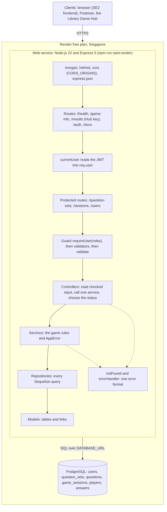
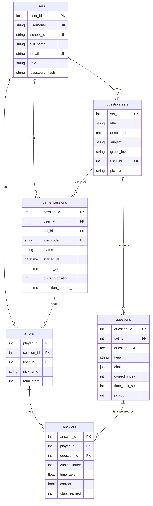

# Technical specification: Libra Quest API

Version 1.0.0, SE1 final build. Developer: Rhona Mae Borje (rhonamaeborje), BSCS 3-2. Group: Group 5.

## 1. Purpose and scope

Libra Quest is a tournament quiz game for the SorSU Bulan Campus library. Players join a game with a six-digit code and a nickname, answer timed multiple-choice questions, earn 5, 3 or 1 stars for a correct answer (the faster the answer, the more stars) and climb a leaderboard. Hosts (librarians or teachers) build question sets and run the games. Admins manage the accounts and the roles. The Library Game Hub reads the finished games from `GET /results` with a key.

SE1 covers the backend: accounts and roles, the question bank, gameplay, the results for the Hub, automated tests, the API documentation and a live deployment on Render. SE2 will add the frontend that calls this API. Not covered in SE1: a frontend, real-time push, load testing and email.

## 2. Architecture

One request passes through these steps, in this order: `morgan` logs it, `helmet` adds safe headers, `cors` checks the origin against `CORS_ORIGINS`, `express.json` reads the body, and the router takes over. The public routes (health, game info, results with the Hub key, the account routes, the docs) are mounted first. Then `currentUser` reads the token into `req.user`. In every protected route the guard (`requireUser`) runs first, then the validators, then `validate`, then the controller, which calls a service, which calls a repository, which uses a model to reach PostgreSQL. If nothing matches, `notFound` answers a JSON 404, and anything thrown ends in `errorHandler`, which answers in one error format.

| Layer | Folder | Responsibility | Never |
|---|---|---|---|
| Routes | `src/routes` | Connect a verb and a URL to its guard, validators and controller | Hold rules or queries |
| Validators | `src/validators` | Describe what every input may look like (type, length, range, allowed values) | Touch the database or decide game rules |
| Controllers | `src/controllers` | Read the checked input with `matchedData`, call one service, choose the status code and the JSON shape | Hold game rules or queries |
| Services | `src/services` | Hold the rules (ownership, frozen sets, scoring, the order of the answer checks) and throw `AppError` | Use `req` or `res`, or write SQL |
| Repositories | `src/repositories` | Hold every database query (Sequelize) | Decide a rule |
| Models | `src/models` | Describe the tables and the links between them | Contain game logic |

## 3. Data

The database has six tables: `users`, `question_sets`, `game_sessions`, `questions`, `players` and `answers`. Every table and column is described in [data-dictionary.md](data-dictionary.md).

The database enforces some rules by itself, and `src/errors/constraint-map.js` turns each violation into a 409 with its own code instead of a 500:

- `school_id`, `username` and `email` are unique in `users` (409 `SCHOOL_ID_TAKEN`, `USERNAME_TAKEN` and `EMAIL_TAKEN`).
- A join code is unique in `game_sessions`.
- One account has one seat in a game (a second join answers 200 with the same seat).
- A player has one answer per question: a second answer for the same question is refused (409).
- Foreign keys tie questions to their set, sessions to their set and host, players to their session, and answers to their player and question.

## 4. Security

| Concern | Decision |
|---|---|
| Passwords | Hashed with bcrypt (`bcryptjs`, cost 10). Only the 60-character hash is stored, in `password_hash`. The model hides it by default, so it is never returned. A password has 8 to 72 characters (bcrypt reads only 72 bytes) with a letter and a number. |
| Login and tokens | `POST /auth/login` returns a JWT (HS256) signed with `JWT_SECRET` that lasts 1 hour (`JWT_EXPIRES_IN`), sent as `Authorization: Bearer <token>`. A missing, changed or expired token is 401 (`AUTH_REQUIRED` or `INVALID_TOKEN`). A wrong password and an unknown school ID give the same 401 `INVALID_CREDENTIALS`, and a dummy hash makes both take the same time, so the login cannot be used to find out which accounts exist. |
| Roles | PLAYER, HOST and ADMIN. Each route lists the roles that may call it (`requireUser('HOST', 'ADMIN')`). The guard runs before validation, so a stranger learns nothing about the rules. A registration always makes a PLAYER (the body is read with `matchedData`, so a `role` sent by the client never arrives), and only an admin can change a role, never their own (409). |
| Input | Every body, parameter and query goes through express-validator. `sort` must be on a fixed list, a search word is bound as a parameter, an upload must be one PNG or JPEG of at most 1 MB and is stored under a name the server chooses, and a question and its position are saved in one transaction. |
| Your game's trust boundary | The server decides everything that decides the score. The answer request carries only `question_id` and `choice_index`. The server measures the time from `question_started_at`, works out the stars, and never sends `correct_index` to a player. The owner of a set is taken from the token, never from the body, and the server sets every question's `position`. |
| Browsers (CORS) | Only the origins listed in `CORS_ORIGINS` may read the API's answers in a browser, and `helmet` sets safe headers. curl and Postman ignore CORS, so it does not protect `/results`. |
| The Hub | `GET /results` needs the `X-Hub-Key` header (`HUB_API_KEY`). Without it the answer is 401 `HUB_KEY_REQUIRED`. The key is kept in the server's settings, never in Git. |

## 5. Quality

- Automated tests: 59 Jest tests in 9 suites, all passing: 23 unit tests and 36 HTTP tests. The unit tests (`tests/unit`) replace the repositories with `jest.mock` and check the scoring at its edges, the order of the answer checks (and that a refused answer saves nothing), the ranks on the leaderboard and the identical login failures. The HTTP tests (`tests/api`) send real requests through the whole app for accounts, users, question sets, sessions and the docs, on a database of their own (`<DB_NAME>_test`) that is rebuilt before every run. Coverage is 64.22% of statements, 38.53% of branches, 48.8% of functions and 64.31% of lines, which means those lines ran, not that they are correct. Branch coverage is lower, so many error paths are not yet tested.
- Postman: one collection with six folders, 90 requests and 162 tests, all passing on a freshly reset database, also from the command line with `newman`. A second collection, "Libra Quest Live Smoke", passes 28 tests against the live server.
- The automatic check (`npm run check`, lines A to O) tests the set-up, secrets, migrations, seed data, Hub endpoints, results, Git history, accounts, the Postman run, gameplay, tests, CORS, the API docs, the live API and this portfolio.

## 6. Deployment

The API runs on Render's free plan, described by `render.yaml`: one web service and one PostgreSQL database in the Singapore region. The start command is `npm run start:render`, which runs the migrations, creates the first admin from `ADMIN_SCHOOL_ID` and `ADMIN_PASSWORD`, and starts the server. The server connects with `DATABASE_URL`. There is no seed data on the server, because the demo password would open accounts on a public API. `JWT_SECRET` is generated by Render, and `HUB_API_KEY`, `CORS_ORIGINS` and the two admin values are typed in the Render dashboard and are never in Git.

The live address is https://libra-quest-rhonamae.onrender.com/api/v1 and the documentation is at https://libra-quest-rhonamae.onrender.com/api/v1/docs/. The free plan puts the service to sleep after 15 minutes without requests and it takes about a minute to wake. The free database expires 30 days after it was created, which for this build is in December 2026. There is no permanent disk, so uploaded cover pictures disappear when the service restarts.

## 7. Decisions and their reasons

| Decision | Reason | Cost I accepted | Alternative not taken |
|---|---|---|---|
| The server measures the answer time | A client can edit anything it sends, so a client-sent time would let a player always take the top bracket | A slow network counts against the player | The client sends `time_taken`, as my Week 7 design did |
| Choices are one JSON array with a single `correct_index` | Exactly one correct answer becomes one number that must point inside the array, which is easy to validate | A choice has no id of its own, so an answer stores a position, not a link to a row | A separate `choices` table with an `is_correct` flag |
| A set used by a game is frozen (409 `SET_IN_USE`) | Changing a question after a game was played would change what the stored answers mean | A host cannot fix a typo in a played set and must make a new one | Copy the set on every edit, or version the questions |
| A wrong password and an unknown school ID answer the same 401 | Different messages would let anyone test which school IDs have accounts | A person who mistyped their ID gets a less specific message | Separate messages for each case |
| No seed data on the live server, and the first admin comes from environment variables | My demo password would open accounts on a public API | The live database starts empty, so I register the host and the players by hand before testing | Run the seeders on the server |
| Stars come from fixed time brackets: 5 within 10 seconds, 3 within 20 seconds, 1 until the time limit, 0 after | It follows my game design and is easy to explain and test at its edges | The brackets are not shares of the limit, so a question with a limit of 10 seconds or less can only give 5 stars or 0 | A continuous formula that shrinks the points with the elapsed time |
| Rules live in services and queries in repositories | A rule can be tested with `jest.mock` in milliseconds, without a database | More files and more calls for a small feature | Put the logic in the controllers |